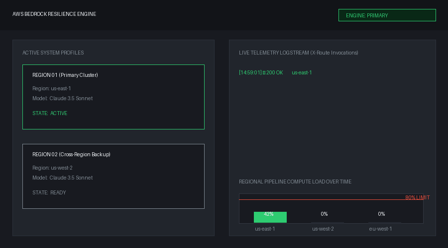

# bedrock-fallback-engine

> AWS-native resilience for Amazon Bedrock. Cross-region, cross-model failover with schema validation and per-route CloudWatch telemetry.

[](https://github.com/Jamie643/bedrock-fallback-engine/actions/workflows/ci.yml)
[](https://www.python.org/)
[](LICENSE)
[](https://github.com/Jamie643/Bedrock-fallback-engine/actions/workflows/publish.yml)

**Watch us-east-1 fail. Watch the request still succeed.** ↓



*Same endpoint. Same response. Different region. Every failover is a CloudWatch metric.*
---

## The problem

Amazon Bedrock throttles. A region goes down. A model hits quota. When that happens mid-agent-workflow, your entire pipeline dies.

`bedrock-fallback-engine` wraps the Converse API in a **route chain**:

- **Cross-region failover** — us-east-1 throttled? Try us-west-2.
- **Cross-model failover** — Claude down? Try Nova.
- **Cross-provider failover** — Bedrock-native models all sick? Try Llama.
- **Schema validation** — malformed JSON fails over to the next route instead of crashing.
- **Token accounting** — every invocation reports input/output tokens and which route served it.

---

## Install

```bash
pip install bedrock-fallback-engine
```

Requires AWS credentials configured (`aws configure`, env vars, or IAM role).

---

## Quickstart

```python
from pydantic import BaseModel
from bedrock_fallback_engine import BedrockFallbackEngine

class Triage(BaseModel):
    category: str
    urgency: str

engine = BedrockFallbackEngine(schema=Triage)

result = engine.invoke([
    {"role": "user", "content": [{"text": "Classify: dashboard won't load."}]}
])

print(result.value)          # {"category": "bug", "urgency": "high"}
print(result.route.label)    # "primary"
print(result.input_tokens)   # 42
print(result.output_tokens)  # 11
```

If the primary region or model fails, the next route runs automatically. If **every** route fails, you get a `BedrockRouteExhausted` with the full error trail — each entry tagged with the route label that produced it.

---

## Default routes

`us-east-1` Claude 3.5 Sonnet → `us-west-2` Claude 3.5 Sonnet → `us-east-1` Nova Pro → `us-west-2` Llama 3 70B

Bring your own:

```python
from bedrock_fallback_engine import BedrockRoute, BedrockFallbackEngine

engine = BedrockFallbackEngine(routes=[
    BedrockRoute("eu-west-1", "anthropic.claude-3-5-sonnet-20241022-v2:0"),
    BedrockRoute("eu-central-1", "amazon.nova-pro-v1:0"),
])
```
## Live failover demo

The `demo/` folder contains a FastAPI app that demonstrates cross-region failover in real time. It runs **without AWS credentials** — the chaos client returns canned responses so you can try it locally in 30 seconds.

### Run it locally

```bash
pip install -e .
pip install -r demo/requirements.txt

BEDROCK_DEMO_DRY_RUN=1 uvicorn demo.app:app --reload
```

Leave that terminal running. Then, in a second terminal, either:

- **Interactive playground:** open `http://localhost:8000/docs` in your browser (FastAPI auto-generates Swagger UI), or
- **Direct `curl` calls:** use the examples below.

### Happy path — served by primary

```bash
curl -i -X POST http://localhost:8000/triage \
  -H 'content-type: application/json' \
  -d '{"text": "My dashboard is broken"}' | grep X-Route
```

```
X-Route-Served-By: primary
X-Route-Region: us-east-1
```

### Failover path — served by backup

Add `?simulate_throttle=true` to force the primary route to fail:

```bash
curl -i -X POST 'http://localhost:8000/triage?simulate_throttle=true' \
  -H 'content-type: application/json' \
  -d '{"text": "My dashboard is broken"}' | grep X-Route
```

```
X-Route-Served-By: cross-region
X-Route-Region: us-west-2
```

**Same response body. Same status code. User never knew.**

### Response headers

Every invocation returns the routing decision as headers — perfect for demos, debugging, and dashboards:

| Header | Meaning |
|---|---|
| `X-Route-Served-By` | Which route label answered |
| `X-Route-Region` | AWS region that answered |
| `X-Route-Model` | Bedrock model that answered |
| `X-Input-Tokens` | Prompt tokens consumed |
| `X-Output-Tokens` | Response tokens generated |
| `X-Latency-Ms` | Route call latency in milliseconds |
| `X-Attempts` | Total attempts before success |

### Endpoints

| Method | Path | Purpose |
|---|---|---|
| `GET` | `/health` | Service health + route list |
| `POST` | `/triage` | Classify a ticket (with automatic failover) |
| `GET` | `/chaos/status` | Which routes are currently forced to fail |
| `POST` | `/chaos/clear` | Reset the chaos set |

### Run with real Bedrock

```bash
export AWS_ACCESS_KEY_ID=...
export AWS_SECRET_ACCESS_KEY=...
export AWS_DEFAULT_REGION=us-east-1
unset BEDROCK_DEMO_DRY_RUN

uvicorn demo.app:app --reload
```

### Run with Docker

```bash
docker build -t bedrock-demo -f demo/Dockerfile .
docker run -p 8000:8000 bedrock-demo
```

Full demo docs: [`demo/README.md`](demo/README.md)

```
## CloudWatch telemetry

Pass a `CloudWatchMetricsEmitter` to get structured metrics on every invocation.

```python
from bedrock_fallback_engine import (
    BedrockFallbackEngine,
    CloudWatchMetricsEmitter,
)

metrics = CloudWatchMetricsEmitter(namespace="MyApp/Bedrock", flush_size=20)
engine = BedrockFallbackEngine(schema=Triage, metrics=metrics)

engine.invoke([...])  # metrics emitted automatically

```

**Metrics emitted:**

| Metric | Unit | Dimensions |
|---|---|---|
| `InvocationCount` | Count | RouteLabel, Region, ModelId, Status |
| `InvocationLatency` | Milliseconds | RouteLabel, Region, ModelId |
| `ThrottleCount` | Count | RouteLabel, Region, ModelId |
| `TransientErrorCount` | Count | RouteLabel, Region, ModelId |
| `FallbackTriggered` | Count | FromRoute, ToRoute |
| `RouteExhausted` | Count | — |
| `InputTokens` | Count | RouteLabel, Region, ModelId |
| `OutputTokens` | Count | RouteLabel, Region, ModelId |

Telemetry is **best-effort** — if CloudWatch is unreachable, the engine keeps working. Buffer auto-flushes at `flush_size` points. Call `metrics.flush()` explicitly at shutdown to drain the buffer.

### Example CloudWatch Insights query

```
fields @timestamp, RouteLabel, FromRoute, ToRoute
| filter MetricName = "FallbackTriggered"
| sort @timestamp desc

```

---

## AWS-native emergency fallback

The default route chain includes **two AWS-native resilience tiers**:

1. **Cross-region inference profile** — `us.anthropic.claude-3-5-sonnet-20241022-v2:0`. Bedrock auto-routes this across any US region with capacity. Platform-level resilience.
2. **Emergency Titan route** — `amazon.titan-text-premier-v1:0`. Amazon's own model. Rarely throttled, always available.

No local AI. No external service. Pure Bedrock → Bedrock → Bedrock failover.

---

## Design principles

1. **Zero surprises.** Route order is explicit; failover is deterministic.
2. **Dependency-light.** Only `boto3` and `pydantic` at runtime.
3. **Two loops, clearly separated.** Retries happen *within* a route; failover happens *between* routes.
4. **Testable.** Inject a fake client factory; no AWS calls in the test suite.
5. **Observable.** Every route attempt, retry, failure, and success emits an event you can hook into CloudWatch, Prometheus, or a logger.

---

## How retries vs. failover work

```
Route 1 (us-east-1, Claude)
 ├─ attempt 1  fail
 ├─ attempt 2  fail  (retry within route)
 └─ attempt 3  fail  → give up on route

Route 2 (us-west-2, Claude)
 └─ attempt 1  success  ← returned
```

Retries (`max_retries`) apply **inside** each route. Failover is **between** routes. When a route can't be saved, the engine doesn't retry it forever — it moves on.

---

## Roadmap

- [x] Cross-region / cross-model failover
- [x] Schema validation with failover
- [x] Structured error trail
- [x] Token usage per invocation
- [ ] CloudWatch metrics emission
- [ ] Local emergency fallback (Ollama)
- [ ] Lambda deployment packaging

---

## License

MIT — see [LICENSE](LICENSE).
